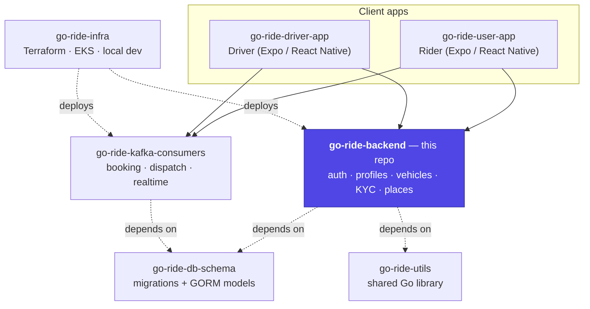
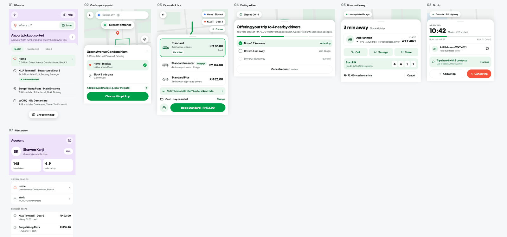
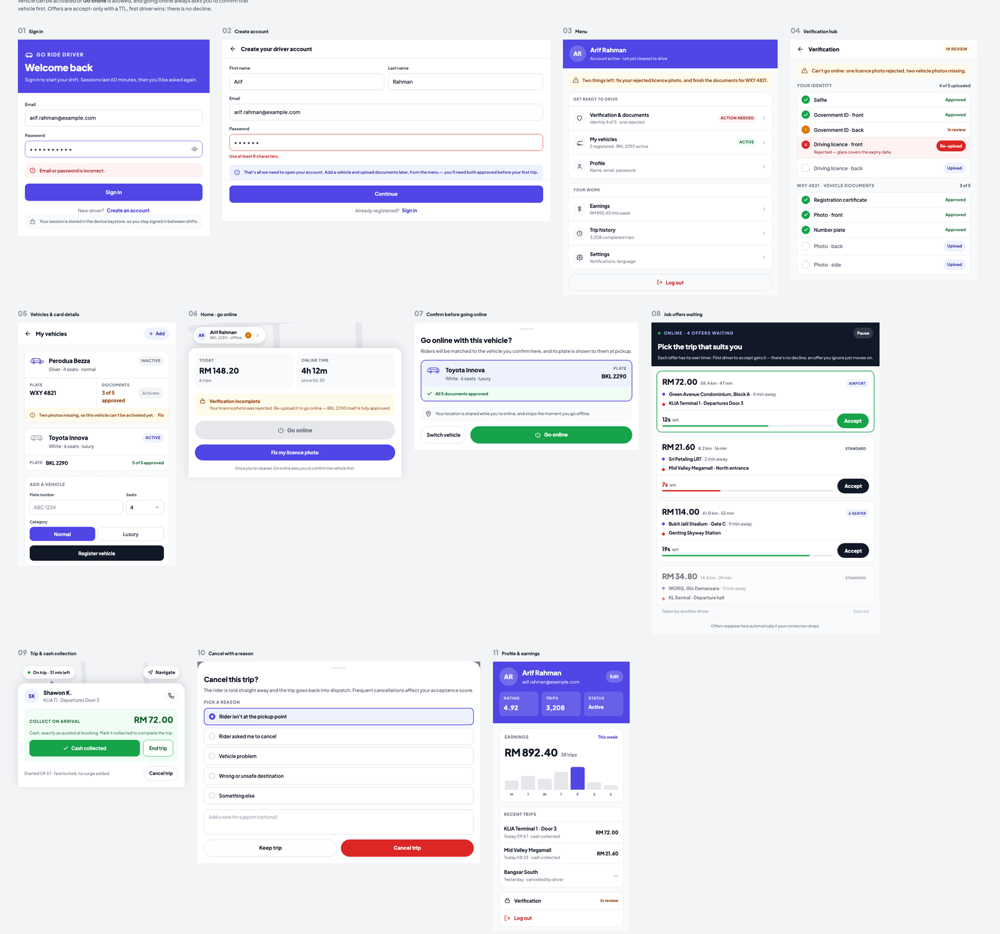
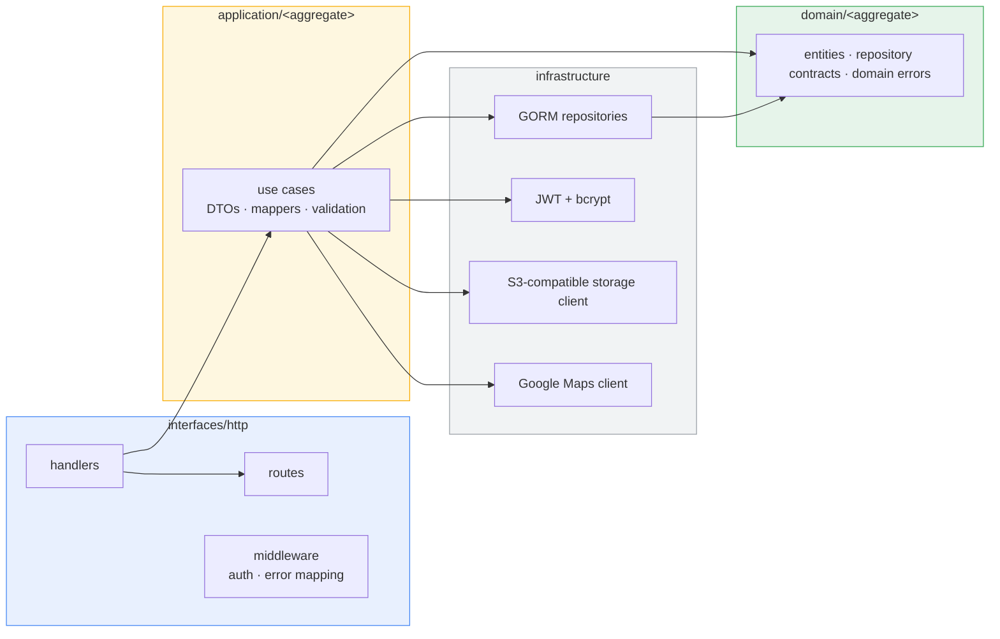

# Go Ride — Backend API

**The identity and driver-onboarding service for Go Ride**, a ride-hailing platform built as a small constellation of independently deployable Go services rather than one monolith. This repo owns everything about a rider or driver that isn't a live trip: signup/login, JWT issuance, profile management, driver vehicle registration, and a two-track KYC document-verification pipeline that gates who is allowed to actually drive.

The realtime booking/dispatch/matching engine that this API's users eventually talk to lives in the sibling repo **[go-ride-kafka-consumers](https://github.com/shawon-kanji/go-ride-kafka-consumers)** — see that repo for the trip lifecycle, the geospatial matching algorithm, and the WebSocket delivery layer.

<p align="center">
  
  
  
  
  
  
  
</p>

---

## Where this fits in the platform

Go Ride is split across seven repositories, checked out as siblings. This one is the **identity and onboarding** service.



| Repo | Role |
|---|---|
| **go-ride-backend** (this repo) | Signup/login + JWT, rider & driver profiles, vehicle registration, KYC document verification, Google Places proxy |
| [go-ride-kafka-consumers](https://github.com/shawon-kanji/go-ride-kafka-consumers) | The realtime core: fare quoting, booking, geospatial dispatch, WebSocket push |
| [go-ride-db-schema](https://github.com/shawon-kanji/go-ride-db-schema) | The single source of truth for the database schema, versioned as a Go module |
| [go-ride-utils](https://github.com/shawon-kanji/go-ride-utils) | Shared Kafka event contracts, topic names, header constants, secrets helper |
| [go-ride-infra](https://github.com/shawon-kanji/go-ride-infra) | Terraform (VPC/EKS/RDS/MSK/ElastiCache) + local `kind`/docker-compose tooling |
| [go-ride-driver-app](https://github.com/shawon-kanji/go-ride-driver-app) | Driver-facing Expo/React Native app |
| [go-ride-user-app](https://github.com/shawon-kanji/go-ride-user-app) | Rider-facing Expo/React Native app |

## What it does

- **Auth** — email/password signup and login for both riders and drivers, issuing role-scoped JWTs (separate `aud` claims for rider vs. driver tokens) with bcrypt password hashing.
- **Profile lifecycle** — view/update profile, change password, deactivate account.
- **Vehicle fleet management** — a driver can register multiple vehicles, but only one may be `is_active` at a time, and activation is blocked until that vehicle clears KYC.
- **Driver KYC** — a two-track verification pipeline: 5 driver-identity documents (selfie, government ID front/back, driving licence front/back) and, per vehicle, 5 more (registration, photo front/back/side, plate). Uploads go straight to S3-compatible storage via presigned URLs — the API never proxies the file bytes.
- **Places proxy** — autocomplete, place details, and reverse-geocoding, server-key-authenticated so the Google Maps key never ships inside a mobile app bundle.

This is deliberately **not** where ride booking happens — see the architecture diagram above. Keeping the rules of "who is allowed on the road" separate from "what happens during a trip" is a conscious boundary, not an oversight.

## Screens this API serves

The rider and driver apps are separate Expo/React Native projects (`go-ride-user-app`, `go-ride-driver-app`), designed against this backend's contracts. Auth, profile, vehicle, and KYC screens below are served directly by this repo; booking/tracking screens are served by `go-ride-kafka-consumers`.

### Rider app



### Driver app — including the KYC verification flow this backend implements



## Architecture

Strict Domain-Driven Design, enforced by [`CONSTITUTION.md`](CONSTITUTION.md) rather than left to convention:



Four aggregates — `user`, `driver`, `vehicle`, `kyc` — each following the identical layer shape, so a new domain is a copy of a known-good pattern rather than a new design decision.

## Tech stack

| Layer | Choice |
|---|---|
| Language | Go 1.25 |
| HTTP | [Gin](https://github.com/gin-gonic/gin) |
| ORM / DB | [GORM](https://gorm.io) + PostgreSQL |
| Auth | JWT ([golang-jwt/jwt/v5](https://github.com/golang-jwt/jwt)) + bcrypt, role-scoped audiences |
| Object storage | S3-compatible (AWS S3 in prod via IRSA, MinIO/AIStor locally), presigned upload URLs |
| Maps | Google Maps Platform — Places, Geocoding |
| Secrets | AWS Secrets Manager in staging/production (via [`go-ride-utils/awssecrets`](https://github.com/shawon-kanji/go-ride-utils)), plain `.env` locally |
| Deploy | Docker + Helm, one chart per environment overlay |

## API surface

**Rider auth & profile** — `/api/v1`

| Method | Path | Auth |
|---|---|---|
| POST | `/auth/signup` | — |
| POST | `/auth/login` | — |
| GET | `/me` | rider JWT |
| PATCH | `/profile` | rider JWT |
| POST | `/change-password` | rider JWT |
| POST | `/deactivate` | rider JWT |

**Driver auth, profile & status** — `/api/v1/driver`

| Method | Path | Auth |
|---|---|---|
| POST | `/driver/auth/signup` | — |
| POST | `/driver/auth/login` | — |
| GET / PATCH | `/driver/profile` | driver JWT |
| PATCH | `/driver/online` | driver JWT — blocked by KYC/vehicle status |
| PATCH | `/driver/pause` | driver JWT |

**Vehicles** — `/api/v1/driver/vehicles`

| Method | Path |
|---|---|
| POST | `/` — register |
| GET | `/` — list |
| GET | `/:id` |
| PATCH | `/:id` |
| POST | `/:id/activate` — blocked until all 5 vehicle documents are approved |
| DELETE | `/:id` |

**KYC** — `/api/v1/driver/kyc`

| Method | Path |
|---|---|
| POST | `/documents/upload-url` — presigned S3 PUT URL |
| POST | `/documents/confirm` — mark an upload complete, moves it into review |
| GET | `/status` — per-document approval state for both tracks |

**Places** — `/api/v1/places` (either role)

| Method | Path |
|---|---|
| GET | `/autocomplete` |
| GET | `/reverse-geocode` |
| GET | `/:place_id` |

All protected routes require `Authorization: Bearer <token>`; the acting user's ID always comes from the token's claims, never from the request body.

## Getting started

```bash
cp .env.example .env

# Backing services (Postgres, S3-compatible storage) live in the sibling
# go-ride-infra repo's consolidated compose file — `make up` delegates there.
make up

go mod tidy
make migrate-up      # delegates to sibling go-ride-db-schema

go run ./cmd/api     # starts on APP_PORT (default 8080)
```

```bash
go build ./...
go vet ./...
gofmt -l .           # must be empty
go test ./...
```

Requires the sibling repos checked out alongside this one: `go-ride-infra`, `go-ride-db-schema`, `go-ride-utils`.

## Deployment

- **Dockerfile**: [`Dockerfile`](Dockerfile) — single-module build.
- **Helm chart**: [`deploy/helm/`](deploy/helm/) — `values.yaml` defaults, plus `values-local.yaml` / `values-staging.yaml` / `values-production.yaml` overlays.
- **Health check**: `GET /healthz` for liveness/readiness probes.
- **Secrets**: in staging/production, DB credentials and the JWT secret are fetched from AWS Secrets Manager at startup (IRSA-authenticated) instead of read from plain env vars — see `internal/config/config.go`.

Cluster/cloud provisioning (Terraform for VPC/EKS/RDS/ECR/IAM) lives in [`go-ride-infra`](https://github.com/shawon-kanji/go-ride-infra) — see its `docs/architecture.md`, `docs/runbook-cluster.md`, and `docs/runbook-local.md`.

## Project structure

```
cmd/api                 entrypoint
domain/{user,driver,vehicle,kyc}        entities, repository contracts, domain errors
application/{user,driver,vehicle,kyc}   DTOs, mappers, validation, use cases
infrastructure/         GORM repos, JWT/bcrypt, S3 client, Google Maps client
interfaces/http/        Gin handlers, routes, middleware
internal/bootstrap      the single dependency-injection composition root
pkg/apperror            domain/validation errors → HTTP responses, in one place
```

See [`CONSTITUTION.md`](CONSTITUTION.md) for the binding conventions behind this layout, and [`doc/PROJECT_ROADMAP.md`](doc/PROJECT_ROADMAP.md) for phase-by-phase status across the whole platform.
